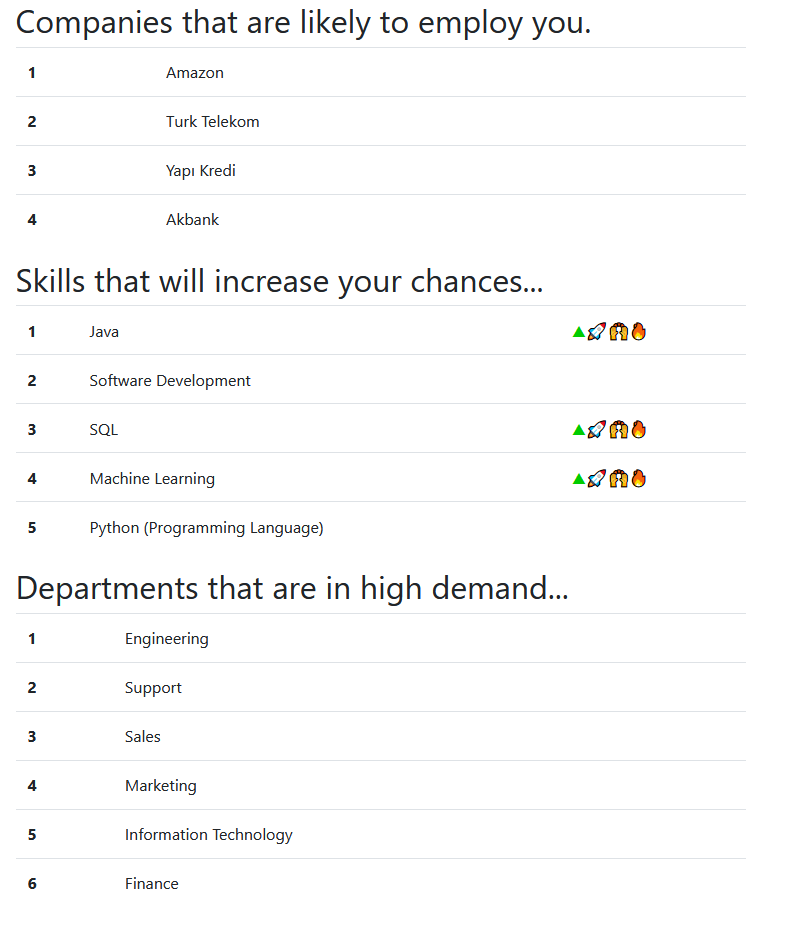

# CareerPath
This project aims to guide its users' career paths. The user will enter their career choice in a query system, the algorithm will calculate a suitable career path based
on collected career data in its database. Each meaningful query has its unique score based algorithm in the backend side of the application. Frontend side will get this
response from the backend and display it to the user in a meaningful table-like format.

You can see the input screen with an example query below, this image also shows autocomplete algorithm, which autocompletes user inputs based on system data:


There are 5 types of queries which user can enter, the user just has to leave other input fields blank (*Pink ones are user inputs, green ones are algorithm outputs*):


Below you can see the output screen of an example query: *"I want to study computer science at Koc University, which career related skills will I gain from it and 
which work profession in which company I will likely end up working for?"*:



**As you can see in the image some skills have marks on them, indicating they are currently trending skills according to the algorithm.**

*A 25 page lengthy scientific report will be provided if asked, it includes how the scoring algorithm works, how the data is collected and formatted. You can also learn about background of the project*


## Installation
Needs Python 3.12 and PostgreSQL (any recent version).

1. Create a virtual environment and install the pinned dependencies:
   ```
   python -m venv .venv
   .venv\Scripts\activate        # Windows; on macOS/Linux: source .venv/bin/activate
   pip install -r requirements.txt
   ```
2. Copy `.env.example` to `.env`. Generate a `SECRET_KEY` with the command in that file and set `DB_PASSWORD` to your PostgreSQL password. `.env` is ignored by git; never commit it.
3. Create the database and load the data:
   ```
   createdb careerpathdb
   psql careerpathdb -c "create table companies(company jsonb);"
   psql careerpathdb -f companyInsert.sql
   ```
4. Create Django's own tables and start the server:
   ```
   python manage.py migrate
   python manage.py runserver
   ```

## Development
```
pip install -r requirements-dev.txt
ruff check .
pytest
```
CI (`.github/workflows/ci.yml`) runs the same checks against a Postgres service on every push.
