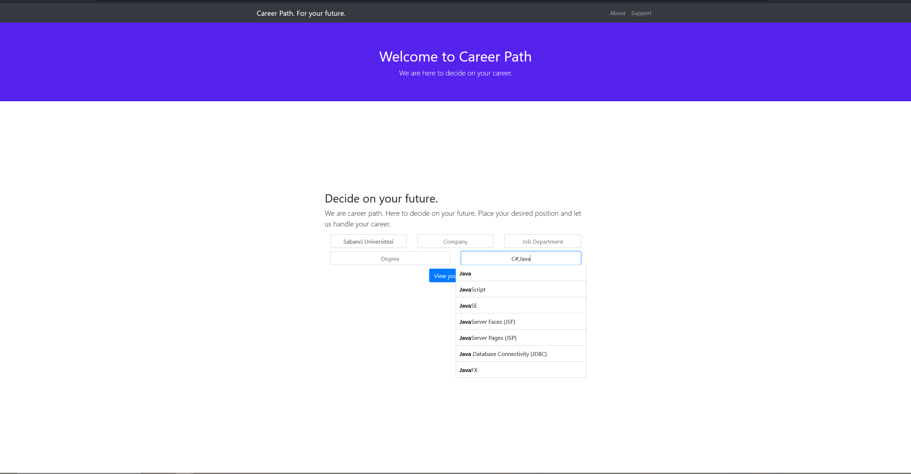

# CareerPath
This project aims to guide its users' career paths. The user will enter their career choice in a query system, the algorithm will calculate a suitable career path based
on collected career data in its database. Each meaningful query has its unique score based algorithm in the backend side of the application. Frontend side will get this
response from the backend and display it to the user in a meaningful table-like format.

You can see the input screen with an example query below, this image also shows autocomplete algorithm, which autocompletes user inputs based on system data:



There are 5 types of queries which user can enter, the user just has to leave other input fields blank (*Pink ones are user inputs, green ones are algorithm outputs*):


Below you can see the output screen of an example query: *"I want to study computer science at Koc University, which career related skills will I gain from it and 
which work profession in which company I will likely end up working for?"*:


**As you can see in the image some skills have marks on them, indicating they are currently trending skills according to the algorithm.**

*A 25 page lengthy scientific report will be provided if asked, it includes how the scoring algorithm works, how the data is collected and formatted. You can also learn about background of the project*


## Data
The repository contains the application code. Newly collected data and the tools that collect it are not published.

Sources: [YÖK Atlas](https://yokatlas.yok.gov.tr), [TÜİK](https://www.tuik.gov.tr), [ISCED-F 2013](https://uis.unesco.org/en/topic/international-standard-classification-education-isced) and the [O\*NET database](https://www.onetcenter.org/database.html).

- Graduate outcome figures: TÜİK (Türkiye İstatistik Kurumu), *Yükseköğretim İstihdam Göstergeleri*.
- This project includes information from the [O\*NET 31.0 Database](https://www.onetcenter.org/database.html) by the U.S. Department of Labor, Employment and Training Administration (USDOL/ETA). Used under the [CC BY 4.0](https://creativecommons.org/licenses/by/4.0/) license. O\*NET® is a trademark of USDOL/ETA. CareerPath has modified all or some of this information. USDOL/ETA has not approved, endorsed, or tested these modifications.

The query screen still runs on an older 2021 dataset (`companyInsert.sql`). It is out of date and will be removed once the new version replaces it.

## Run with Docker
For local development; needs only Docker with Compose. The database is a separate one inside Docker, so it starts empty.

1. Copy `.env.example` to `.env` and set `SECRET_KEY` (any long random string; avoid `$`) and `DB_PASSWORD` (pick one; avoid `$`).
2. Start the app, then open http://localhost:8000. With `--watch`, code changes are copied into the running container:
   ```
   docker compose up --build --watch
   ```
3. In a second terminal, as needed:
   ```
   docker compose exec web python manage.py createsuperuser   # login for /admin/
   docker compose exec web pytest
   ```
   Optional: load the old 2021 data. Only the query screen uses it, and its searches fail without it:
   ```
   docker compose cp companyInsert.sql db:/tmp/companyInsert.sql
   docker compose exec db psql -U postgres -d careerpathdb -c "create table companies(company jsonb);" -f /tmp/companyInsert.sql
   ```

`docker compose down` stops the app and keeps the data; `docker compose down -v` deletes it. `DB_PASSWORD` only takes effect when the database is first created.

## Installation without Docker
Needs Python 3.12 and PostgreSQL (any recent version).

1. Create a virtual environment and install the pinned dependencies:
   ```
   python -m venv .venv
   .venv\Scripts\activate        # Windows; on macOS/Linux: source .venv/bin/activate
   pip install -r requirements.txt
   ```
2. Copy `.env.example` to `.env`. Generate a `SECRET_KEY` with the command in that file and set `DB_PASSWORD` to your PostgreSQL password. `.env` is ignored by git; never commit it.
3. Create the database. PostgreSQL's `bin` folder must be on your PATH (the Windows installer doesn't add it). These commands assume a `postgres` superuser with a password, as the Windows installer creates. On Linux (apt), first give it one with `sudo -u postgres psql -c "ALTER USER postgres PASSWORD 'yourpw'"`. On macOS (Homebrew), drop `-U postgres` and set `DB_USER` in `.env` to your login name:
   ```
   createdb -h localhost -U postgres careerpathdb
   ```
   Optional: load the old 2021 data. Only the query screen uses it, and its searches fail without it. The client encoding is set to UTF-8 so Turkish characters load correctly on Windows:
   ```
   psql -h localhost -U postgres -d careerpathdb -c "create table companies(company jsonb);"
   psql -h localhost -U postgres -d careerpathdb -c "\encoding UTF8" -f companyInsert.sql
   ```
4. Create Django's own tables and start the server:
   ```
   python manage.py migrate
   python manage.py runserver
   ```

## Development
```
pip install -r requirements-dev.txt
ruff check .
pytest
```
`pytest` needs the PostgreSQL server from step 3 running. CI (`.github/workflows/ci.yml`) runs these checks plus `manage.py check --deploy` and `makemigrations --check` against a Postgres service on every push. It also builds and starts the Docker setup, loads the home page and runs `pytest` inside it.
